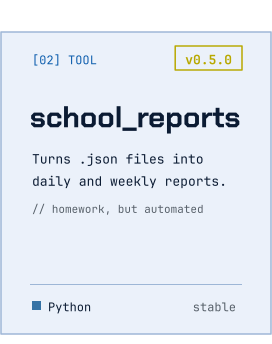
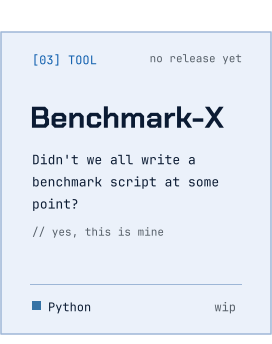

<picture>
  <source media="(prefers-color-scheme: dark)" srcset="generated/intro/intro-dark.svg">
  
</picture>

<picture>
  <source media="(prefers-color-scheme: dark)" srcset="generated/headings/skills-dark.svg">
  
</picture>

<picture>
  <source media="(prefers-color-scheme: dark)" srcset="generated/skills/skills-dark.svg">
  
</picture>

<picture>
  <source media="(prefers-color-scheme: dark)" srcset="generated/headings/projects-dark.svg">
  
</picture>

<table><tr>
<td width="33%"><a href="https://github.com/XOYZ69/yoshida"><picture>
  <source media="(prefers-color-scheme: dark)" srcset="generated/projects/yoshida-dark.svg">
  
</picture></a></td>
<td width="33%"><a href="https://github.com/XOYZ69/school_reports"><picture>
  <source media="(prefers-color-scheme: dark)" srcset="generated/projects/school_reports-dark.svg">
  
</picture></a></td>
<td width="33%"><a href="https://github.com/XOYZ69/Benchmark-X"><picture>
  <source media="(prefers-color-scheme: dark)" srcset="generated/projects/benchmark-x-dark.svg">
  
</picture></a></td>
</tr></table>

<picture>
  <source media="(prefers-color-scheme: dark)" srcset="generated/headings/contact-dark.svg">
  
</picture>

<table><tr>
<td width="33%"><picture>
  <source media="(prefers-color-scheme: dark)" srcset="generated/contacts/discord-dark.svg">
  
</picture></td>
<td width="33%"><a href="mailto:xoyz@nyarch.de"><picture>
  <source media="(prefers-color-scheme: dark)" srcset="generated/contacts/mail-dark.svg">
  
</picture></a></td>
<td width="33%"><a href="https://github.com/XOYZ69"><picture>
  <source media="(prefers-color-scheme: dark)" srcset="generated/contacts/github-dark.svg">
  
</picture></a></td>
</tr></table>

<a href="https://github.com/XOYZ69/yoshida">
<picture>
  <source media="(prefers-color-scheme: dark)" srcset="generated/footer/footer-dark.svg">
  
</picture>
</a>
