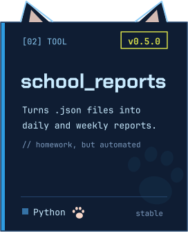
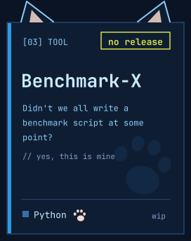

I'm a German guy who is addicted to programming and anime, trying to learn Japanese on the side while also further increasing my knowledge in my techstack. I'm always open for contact so just write me :D

### `> user.get_techstack()`

### `> user.get_projects()`

The projects listed here are the ones I feel comfy sharing. Do **not** expect a stable experience unless there is a stable release :P

<table><tr>
<td width="33%"></td>
<td width="33%"></td>
<td width="33%"></td>
</tr></table>

### `> user.contact()`

The cards above are drawn by <a href="https://github.com/XOYZ69/yoshida">Yoshida</a> from <a href="yoshida">this folder</a>, rebuilt daily from live GitHub data.
